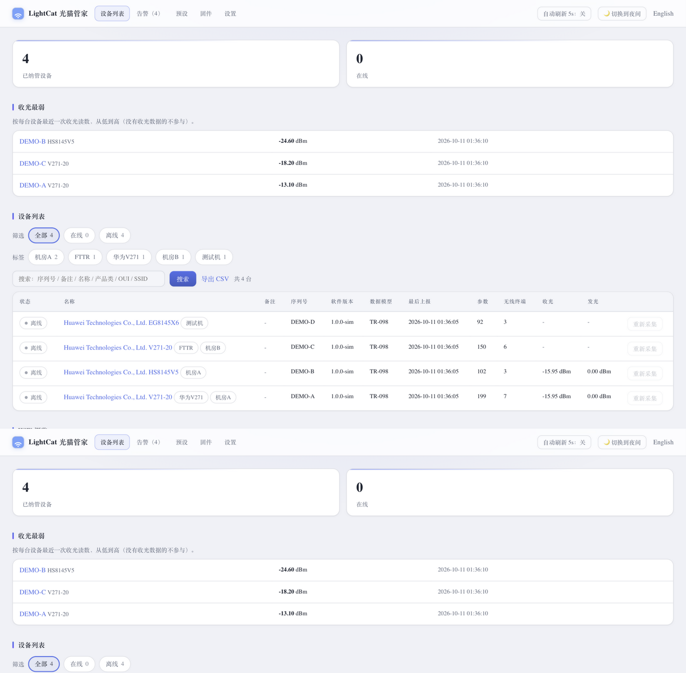
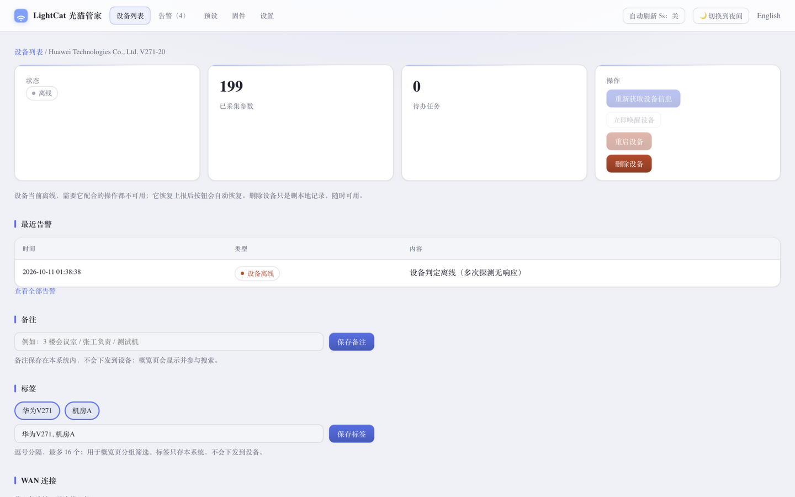
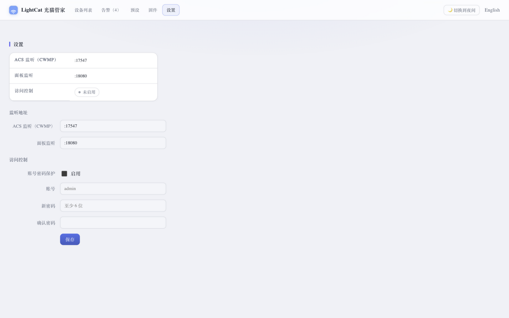

# LightCat ONT Manager

[简体中文](README.md) | **English**

> This project is a fork of [hakureiyuyuko/go-acs](https://github.com/hakureiyuyuko/go-acs) (AGPL-3.0).
> On top of the original TR-069 ACS it adds the **ontweb web-adapter channel** — onboard a real device
> with its normal (user-level) account when the carrier super-admin is not available.
> Released under the same AGPL-3.0 license.

A single-binary, zero-external-dependency TR-069/CWMP ACS (Go + SQLite) for managing a fleet of ONTs / FTTR
gateways: **onboard → inspect → configure → diagnose → manage sub-devices and clients**.


## Features

- **Single-file deployment**: one static binary plus one SQLite file — no Redis / MySQL / message queue
- **Standard protocols only**: Inform, GetParameterValues / Names, SetParameterValues, GetRPCMethods, Reboot,
  IPPingDiagnostics, Connection Request (with HTTP Digest); no vendor-private services involved
- **Real-device verified: Huawei V271-20** (China Unicom, firmware V5R023C10S326) — **no carrier
  super-admin needed**: the modem's plain web account is enough via the ontweb adapter for full
  onboarding — device info, Wi-Fi & FTTR sub-gateways, online clients, and Tx-power / temperature /
  voltage / bias time series (see "Web adapter channel" below); once super-admin access is
  available, point the ACS URL here and the same device merges into TR-069 management
- **Probe first, then display**: capability probing decides which blocks the UI shows (WAN, FTTR sub-devices…);
  if it can't be probed, the whole block is hidden — no empty shells
- **Faithful to actual device behavior**: parameters that are writable but not readable, wireless parameters that
  take effect asynchronously, fields the device never reported (shown as `N/A`) — no invented numbers
- **Bilingual panel (Chinese / English)**: one-click switch in the top-right (`?lang=` + cookie + browser language
  negotiation), with tests guarding against untranslated strings
- **No actions offered on offline devices**: buttons that need the device to cooperate (re-fetch, wake, reboot,
  diagnostics) are greyed out while offline; local operations such as deleting a device still work
- **Online status derived from the device's own interval**: if nothing is reported for more than
  `report interval × 2`, the ACS probes the device with Connection Request three times, and only marks it offline
  when all probes fail (a powered-off device sends no TR-069 notification, so this is the only way to confirm)
- **Operable**: persistent task queue, one-click device wake-up, reboot / delete device, a dedicated panel login
  page (session cookie, with logout), and retention limits for task and inform history
- **Vendor-specific parameters have a mapping table**: every vendor names optical power / temperature
  differently (and some report raw optical-module register values), so those mappings live in the
  database (`param_aliases`) — supporting a new ONT is a few rows of data (`lightcat alias add`), and
  unregistered models still fall back to leaf-name heuristics rather than showing nothing or invented numbers
- **No command line needed to change listen ports**: after editing the addresses on the settings page, click
  “Restart the service now” and the process swaps itself (unchanged ports hand their sockets to the new
  process, so device informs never drop; a port that won't come up is rolled back on the spot)
- **Optical power trend charts**: Rx / Tx / module temperature are stored per collection (both the TR-069 and
  the web-adapter channels feed the same history table) and rendered as server-side SVG sparklines on the device
  page — zero frontend dependencies; readings a channel can't provide (e.g. Rx via the web adapter) are simply
  not drawn rather than invented
- **Threshold alerts**: low Rx power / module overheat / optical port down / device offline are recorded
  automatically, visible on the panel's Alerts page; set `-alert-webhook` to also POST a JSON payload
  (bring your own relay for Telegram / WeChat Work / Home Assistant — no third-party SDK is bundled);
  same-kind alerts share a cooldown window so a persistent breach won't spam
- **Presets**: "which actions to apply on which event/condition" is pure data, managed on the panel —
  when a device Inform matches, the actions are delivered in order **within the same session**
- **Firmware upgrade over TR-069**: upload an image on the panel → deploy (Download task, DelaySeconds for
  staggering) → the device pulls it from the built-in file service → TransferComplete settles the task
- **HTTPS**: set `-tls-cert` / `-tls-key` and both the ACS and panel listeners switch to TLS
- **Observable & scriptable**: `/metrics` serves Prometheus text format; `/api/*` and `/metrics` accept a
  Bearer API token (`-api-token`) so scripts and scrapers need no panel session
- **Ops grouping & reporting**: device tags (location / purpose / batch — filterable on the overview page,
  same filter in the API and CSV); a "Weakest RX power" board on the overview (each device's latest RX
  reading, lowest first); device list and optical history export as CSV (UTF-8 with BOM, opens cleanly in Excel)
- **CloudWeGo Hertz engine**: the HTTP layer runs on Hertz (netpoll); `/api/*` routes and the
  biz three-layer layout are generated by hz from `idl/lightcat_api.proto`; the TR-069 protocol
  core stays dependency-free and is covered by 415 end-to-end assertions plus GenieACS interop
- **Three deployment shapes**: binary + systemd (one-command install/upgrade/rollback), Docker (compose up,
  multi-arch images, non-root, built-in healthcheck), Kubernetes (StatefulSet + PVC + kustomize, probes and
  security context included); state always lives in a single directory — backing up is copying it

## Screenshots

> Data comes from the CPE simulator bundled with this repository; no real device information is included.

Overview: stat cards + weakest-RX board + device list (online status, serial, software version, tags, last inform
time, collected parameter count, wireless client count — plus Rx / Tx optical power columns whenever any device
reports them; filterable by online / offline / tag, with a 5-second auto-refresh toggle in the top-right)
plus Wi-Fi overview and CSV export



Basic information (including optical module readings: Rx / Tx power, temperature, voltage, bias current),
WAN connections, operations (wake / reboot / delete), notes; the same 5-second auto-refresh
toggle (shared with the list page) is in the top-right



Settings: listen addresses for the ACS and the panel, plus the panel login credentials
(port changes take effect after restart, credentials take effect immediately); after changing an address you
can click “Restart the service now” instead of going back to the command line



## Install (release package)

Download the package for your architecture from
[Releases](https://github.com/hakureiyuyuko/go-acs/releases), extract it, and install it as a systemd service
with one command:

```bash
VERSION=1.3.0                                   # replace with the version you downloaded (≤1.2.x tarballs are named acs-*)
tar xzf lightcat-$VERSION-linux-amd64.tar.gz
cd lightcat-$VERSION-linux-amd64
sudo ./install.sh                                                # by default both CWMP and panel use :7547
sudo ./install.sh --web-listen :8080 --web-user admin --web-pass 'change-me'
```

When done, it prints the panel address and the ACS URL to configure on the ONT (`http://<host-ip>:7547/acs`).
Afterwards:

```bash
sudo ./update.sh         # upgrade: verify SHA256 → stop → backup → swap → health check, auto-rollback on failure
sudo ./uninstall.sh      # uninstall: keeps database and config by default; --purge removes data too
```

Default locations: binary `/usr/local/bin/lightcat`, data `/var/lib/lightcat`, config `/etc/default/lightcat`,
service `acs`. The `README.md` inside the package documents all options and directories.

## Quick start (from source)

```bash
go build -o lightcat ./cmd/lightcat        # Go 1.27+; CGO_ENABLED=0 for a static binary
./lightcat -listen :9090 -db lightcat.db   # panel http://<IP>:9090/ , CWMP http://<IP>:9090/acs
```

Building release packages:

```bash
scripts/build-release.sh v1.2.3   # output in dist/: amd64 + arm64 tarballs and SHA256SUMS
```

On the device side, set the ACS URL to `http://<IP>:9090/acs`; real devices have also been seen configured with
the root path `/`, so both are accepted. When the panel is moved to its own port (`-web-listen :8080`), the CWMP
side **accepts any path**, so you don't have to worry about how carrier-customized devices write it.

No device needed to try it: the repository ships a simulator (with FTTR sub-devices, writable-but-unreadable
parameters, asynchronous diagnostics, and more).

```bash
go build -o cpesim ./test/cpesim
./cpesim -acs http://127.0.0.1:9090/acs -serial DEMO0123 -fttr 3 -fttr-optical
```

## Container deployment (Docker / Kubernetes)

```bash
# Docker: one command (panel :8080, CWMP :7547, data in ./data)
LIGHTCAT_PASS='your-strong-password' docker compose up -d
```

For Kubernetes use `deploy/k8s/` (StatefulSet + PVC; **single replica is a hard
constraint** — SQLite has one writer, upgrades stop the old pod before starting the
new one, never two instances on the same volume):

```bash
kubectl create namespace lightcat
kubectl -n lightcat create secret generic lightcat-secret \
  --from-literal=ACS_WEB_USER=admin --from-literal=ACS_WEB_PASS='your-strong-password'
kubectl apply -k deploy/k8s/ -n lightcat
```

Multi-arch images (amd64 / arm64), non-root. Whichever way you deploy, all state
lives in one directory (SQLite database + firmware files) — backing up is copying it.
Everything is configured through `ACS_*` environment variables (one-to-one with the
CLI flags). See [deploy/DOCKER.md](deploy/DOCKER.md) and
[deploy/k8s/K8S.md](deploy/k8s/K8S.md).

## Web adapter channel (ontweb) — onboard a device without carrier super-admin

TR-069 requires pointing the device's ACS URL at this ACS, and that settings page is usually
only reachable with the carrier's super-admin account. `ontweb` is a complementary channel: using
the **normal (user-level) account** of the device's own web UI, it reads the AJAX parameter API
(`getajax.cgi` — essentially TR-181 over HTTP) and stores the results into the **same database**
in standard TR-098 parameter shape — the device list / detail page / optical readings / FTTR
sub-devices / client tree all work in the existing panel, unchanged.

```bash
go build -o lightcat ./cmd/lightcat
ONT_USER=user ONT_PASSWORD='device password' lightcat ontweb -db lightcat.db -url http://192.168.1.1
```

**Real-device verified (2026-10-11)**: full chain with a plain account on a Huawei V271-20
(firmware V5R023C10S326) — profile auto-matched, 399 parameters onboarded, 64 clients (including
3 FTTR sub-ONTs and the 35 clients behind them), optical Tx power / temperature / voltage / bias
current all read (**Rx is not exposed to plain accounts, so it is stored NULL honestly** and the
trend chart draws only the Tx line); both the one-shot CLI collection and the server-side built-in
polling (`-ontweb-url` & friends) passed.

- **What is collected**: device info (model / serial / SW & HW versions / CPU & memory usage),
  optical readings (TX power / temperature / voltage / bias — raw register values stored, the
  optical alias table is registered automatically), online clients (IP / MAC / port / traffic / state)
- **FTTR modelling**: the sub-gateway found on each ONU port (e.g. K251e) becomes a card and its
  downstream clients go into that sub-device's association table; LAN and master-side Wi-Fi
  clients are stored as parameters only — the client tree answers "who is on which WLAN", nothing is invented
- **Identity merges later**: the device triple uses the real serial number (OUI = first 6 chars).
  Once you do get super-admin access and point the device's TR-069 ACS URL here, it merges into
  the same device and real Inform data takes over
- **Honestly labelled**: parameters carry `source=web`, events show `6 WEBPOLL` — clearly
  distinguishable from TR-069-collected data

Limits, stated plainly: this channel is **read-only** (config changes / reboot / diagnostics still
require real TR-069); the Rx-power column shows `-` (the normal-user pages don't expose uplink Rx);
client hostnames depend on whatever the device's pages resolve. The login handshake and page
structure were verified on a Huawei V271-20 (V5R023 firmware); page paths, the handshake and the
parsing regexes all live in per-model **profiles** in `internal/ontweb/profile.go` — like
`param_aliases`, supporting a new model is adding a profile (data), not changing the architecture.
Pages that fail to parse are reported honestly ("profile mismatch + detected model/firmware"),
never swallowed silently.

## Configuration

Command-line flags and environment variables map one-to-one (environment variable name = `ACS_` + flag name
uppercased, hyphens replaced with underscores).

| Flag | Environment variable | Default | Description |
| --- | --- | --- | --- |
| `-listen` | `ACS_LISTEN` | `:7547` | CWMP listen address |
| `-web-listen` | `ACS_WEB_LISTEN` | empty | Panel listen address; empty = same port as CWMP |
| `-path` | `ACS_PATH` | `/acs` | CWMP endpoint path (used when sharing a port) |
| `-db` | `ACS_DB` | `lightcat.db` | SQLite file path |
| `-user` / `-password` | `ACS_USER` / `ACS_PASSWORD` | empty | Device-side HTTP authentication (CPE basic auth) |
| `-web-user` / `-web-pass` | `ACS_WEB_USER` / `ACS_WEB_PASS` | empty | Panel login credentials (seeded on first start; afterwards the settings page wins) |
| `-max-params-per-request` | `ACS_MAX_PARAMS_PER_REQUEST` | `200` | How many parameter names to send per GetParameterValues |
| `-task-history-limit` | `ACS_TASK_HISTORY_LIMIT` | `500` | Task records retained per device (`0` = unlimited) |
| `-inform-history-limit` | `ACS_INFORM_HISTORY_LIMIT` | `500` | Inform records retained per device (`0` = unlimited) |
| `-offline-after` | `ACS_OFFLINE_AFTER` | `10m` | How long without an inform counts as offline (fallback when the device does **not** report its interval) |
| `-offline-probe` | `ACS_OFFLINE_PROBE` | `true` | Probe actively before marking offline; `false` = pure timeout |
| `-offline-probe-factor` | `ACS_OFFLINE_PROBE_FACTOR` | `2` | Start probing after `report interval × this factor` with no inform |
| `-offline-probe-attempts` | `ACS_OFFLINE_PROBE_ATTEMPTS` | `3` | Maximum probe attempts before marking offline |
| `-offline-probe-interval` | `ACS_OFFLINE_PROBE_INTERVAL` | `15s` | Interval between two probes |
| `-offline-probe-grace` | `ACS_OFFLINE_PROBE_GRACE` | `30s` | How long to wait after the last probe before marking offline |
| `-offline-probe-max` | `ACS_OFFLINE_PROBE_MAX` | `0` | Upper bound for `interval × factor` (`0` = none; useful when a device reports a very large interval) |
| `-offline-check-interval` | `ACS_OFFLINE_CHECK_INTERVAL` | `30s` | How often the background checker sweeps online status |
| `-auto-fetch-wifi` | `ACS_AUTO_FETCH_WIFI` | `true` | Automatically collect wireless overview and host list on onboarding |
| `-auto-refresh-wifi` | `ACS_AUTO_REFRESH_WIFI` | `10m` | Auto-refresh interval for the wireless / client overview (the "collected at" time on the panel moves accordingly; `0` = collect only once at onboarding) |
| `-probe-capabilities` | `ACS_PROBE_CAPABILITIES` | `true` | Run capability probing once on onboarding (decides UI blocks) |
| `-log-level` | `ACS_LOG_LEVEL` | `info` | `debug` / `info` / `warn` / `error` |
| `-log-soap` | `ACS_LOG_SOAP` | `false` | Print raw SOAP messages (for troubleshooting) |
| `-acs-url` | `ACS_URL` | empty | ACS address **as seen by devices**; used to build firmware download URLs (falls back to the panel host with a warning if unset) |
| `-optical-history-days` | `ACS_OPTICAL_HISTORY_DAYS` | `30` | Days of optical power history kept for trend charts (`0` = unlimited) |
| `-alert-webhook` | `ACS_ALERT_WEBHOOK` | empty | Alert webhook URL (POST JSON; empty = record only, no push) |
| `-alert-rx-low` | `ACS_ALERT_RX_LOW` | `-27` | Alert when Rx power drops below this (dBm; `0` = rule off) |
| `-alert-temp-high` | `ACS_ALERT_TEMP_HIGH` | `70` | Alert when module temperature exceeds this (°C; `0` = off) |
| `-alert-offline` | `ACS_ALERT_OFFLINE` | `true` | Alert when a device is marked offline |
| `-alert-cooldown` | `ACS_ALERT_COOLDOWN` | `6h` | Cooldown window for same-device same-kind alerts |
| `-files-dir` | `ACS_FILES_DIR` | `files` | Directory of the firmware/config file library |
| `-tls-cert` / `-tls-key` | `ACS_TLS_CERT` / `ACS_TLS_KEY` | empty | HTTPS certificate/key (PEM; both set = ACS and panel switch to TLS) |
| `-api-token` | `ACS_API_TOKEN` | empty | Bearer token for `/api` and `/metrics` (empty = panel session only) |

### Panel login

The panel uses a **dedicated login page + session cookie** (not HTTP Basic): any page accessed while logged out
redirects to `/login`; once logged in the session lasts 7 days and is renewed automatically while in use, with a
"Logout" button in the top bar. The session is an HMAC-signed cookie (HttpOnly + SameSite=Lax, key stored in the
database so it survives restarts); **changing the credentials immediately invalidates all existing sessions**.
API routes (`/api/*`) return 401 JSON when logged out; static assets require no login.

Forgot the password: start once with `ACS_WEB_AUTH=off` to get in and change it, or clear `web_user`/`web_pass`
from the database.

### How online status is decided

When a device loses power, TR-069 sends the ACS **no** notification (the ACS only knows a device is alive when the
device connects to it), so online status is derived from "how long has it been silent", tied to the interval the
device itself reports:

```
last inform + report interval × 2     → start active probing: send Connection Request
  up to 3 probes (15s apart)          → one succeeds: device is still alive, stays online
  all 3 fail + 30s more               → mark offline
device reports no interval            → fall back to -offline-after (default 10 minutes) pure timeout
```

The UI has three states: **online** / **probing** (overdue, being probed) / **offline**.
As soon as the device informs again (including reconnecting after being woken), it returns to online and its
probing progress is cleared.

### Threshold alerts

Four kinds are recorded automatically: Rx power below `-alert-rx-low` (default -27 dBm, around the GPON
sensitivity floor), module temperature above `-alert-temp-high` (default 70 °C), optical port status other
than Up (reported by the web-adapter channel), and device marked offline. Records land in the `alerts` table
and show up on the Alerts page (badge count in the top bar) plus a "Recent alerts" block on the device page.
A cooldown window (`-alert-cooldown`, default 6h) suppresses repeats per device and kind. With
`-alert-webhook` set, each new alert is also POSTed as JSON (kind / message / value / threshold / serial /
timestamp; 10s timeout, no retry — the database record is the source of truth, the push is best-effort).
Missing readings are never evaluated: no data, no alert.

### Presets

Managed on the panel's Presets page — **data, not code**. Trigger: any Inform event code (0 BOOTSTRAP,
1 BOOT, 2 PERIODIC, …) and/or "first provision", optionally gated by a parameter condition (name-suffix
match with eq / ne / contains / exists). Actions are one per line: `SET name=value|type` and `GET name`
(adjacent same-kind lines merge into a single RPC). When an Inform matches, actions are enqueued and
delivered **in the same session**. Presets fire once per device by default; editing a preset clears its
fire records so the change takes effect again.

### Firmware upgrade

Panel → Firmware: upload images (stored under `-files-dir` with server-generated random hex names; the
user-supplied name is metadata only; SHA-256 and size recorded), then deploy to a device: a Download task
is queued (with optional DelaySeconds for staggering), the device pulls the file itself from
`/files/<random-name>` (built-in file service; mounted on the CWMP side in dual-port deployments), and its
TransferComplete(CommandKey) settles the task in the history. The pickup endpoint has no panel auth
(devices can't log in); it is protected by 128-bit random names, database registration checks and exact
matching (no directory listing). Download URLs are built from `-acs-url` (the address as seen by devices);
without it the panel host is used as a fallback with an explicit warning.

### HTTPS, /metrics and API token

`-tls-cert` + `-tls-key` (PEM, must be a pair) switch both listeners to TLS; an unreadable certificate
fails fast at startup. `GET /metrics` serves Prometheus text format (0.0.4) built from a single `Stats()`
query — devices/online/probing, stored params, tasks (pending/running/failed), and the capped sizes of the
inform/alert/optical-history tables (gauges, honestly — not counters). When panel auth is on, `/api/*` and
`/metrics` accept either the panel session cookie or `Authorization: Bearer <token>` (`-api-token`,
constant-time comparison); unauthenticated machine endpoints get 401 JSON, never a login redirect.

### Tags, weakest-RX board and CSV export

- **Device tags**: the "Tags" block on the device page (comma-separated, up to 16, overlong ones truncated).
  Purely panel-side ops grouping (location / purpose / batch) — **stored locally, never sent to devices**.
  The overview page gets a tag chip bar: click to filter (shareable URLs), and the tag badges in device rows
  are clickable too. `/api/devices?tag=` and the CSV export share the same filter. Tags cascade away when a
  device is deleted.
- **Weakest-RX board**: a new block on the overview page — each device's **latest** RX reading, lowest first,
  top 5 (devices without RX data are excluded; NULLs never pose as the worst). The two stat cards
  (Managed devices / Online) stay as they are by design; the alerts entry has always been in the top bar.
- **CSV export**: "Export CSV" next to the search bar (device list: serial / vendor+model / online / tags /
  note / latest optical readings, honoring the current tag filter); "Export history CSV" under the trend
  charts on the device page (full optical history, `?limit=` adjustable). UTF-8 with BOM so Excel opens it
  without mojibake; auth is the same as `/api/*` (panel session or Bearer token).

## Verification

```bash
go test ./...                   # unit tests: protocol parsing / store / web
bash scripts/verify-s1.sh       # 415 end-to-end checks: simulator drives real HTTP + SOAP, asserted one by one
                                # (incl. full firmware deploy / preset / alert flows; 3 browser checks skip without headless Chrome)
bash scripts/verify-interop.sh  # 8 interoperability checks against GenieACS's official JS simulator
```

## Load testing

```bash
scripts/loadtest.sh                     # ladder 10/50/100/200/400, each step on a fresh database
scripts/loadtest.sh -n 200 -e 4484      # run a single step (-e = number of X_HW_APDevice subtree params per device)
```

The device template follows a real Huawei V271-20 (TR-098, 3 FTTR sub-devices, 4484 parameters in the
`X_HW_APDevice` subtree, ~4700 parameters per device), with all devices sending `1 BOOT` simultaneously to
simulate **a large-scale power-recovery storm**.

Measured on this machine (4 cores): about **4 devices/second** (16k–18k parameter rows/s) — 100 devices up at once
finish in 26 seconds, 200 take about a minute, 400 about two minutes; all data is persisted, it's just that
devices exceeding the CPE's 30-second timeout wrap up on their next periodic inform. The bottleneck is SQLite's
single-connection serialized writes (**don't increase the connection pool** — it loses writes in practice).
Methodology and full data in `docs/notes/loadtest.md`.

## Layout

```
cmd/lightcat/            program entry point (listeners, graceful shutdown, dual-port routing)
internal/cwmp/      protocol core: SOAP encode/decode, sessions, tasks, diagnostics, Connection Request
internal/store/     SQLite: devices / parameters / tasks / inform records (migrations via user_version)
internal/web/       web UI and JSON API (templates + a little vanilla JS, no frontend framework)
test/cpesim/        purpose-built CPE simulator (many switches; the verification suite relies on it)
deploy/             install / update / uninstall scripts and systemd unit template for release packages
scripts/            packaging, verification, load testing, reference-implementation fetch, dev start/stop scripts
docs/               requirements docs, release notes, and implementation notes
```

## More

- `docs/requirements.md` — requirements and implementation progress
- `docs/notes/deploy.md` — implementation notes for the installer and deploy scripts (systemd hardening,
  upgrade rollback, how it was verified) — *in Chinese*
- `docs/notes/i18n.md` — the panel's i18n approach (why Chinese literals are used as keys, how to add a language)
  — *in Chinese*
- `docs/notes/loadtest.md` — **load test records**: concurrency ceiling for a mass power-on, the bottleneck
  (SQLite single connection), and measured data — *in Chinese*
- `docs/notes/implementation-notes.md` — **real-device pitfalls and measurements**: protocol edge cases (per-call
  GetParameterValues limits, type case-sensitivity on write-back, diagnostics needing `Requested` set last),
  device quirks (writable-but-unreadable, asynchronous effect, identity keys rewritten by metadata), operations
  pitfalls (don't blindly delete when a mount drops, don't leave tasks stuck in running)… fixes and verification
  included — *in Chinese*

Real-device samples and documents in this repository are **sanitized** (serial numbers, MACs, SSIDs, private IPs,
and client names replaced with example values); the runtime database `data/` and logs are not committed.

## License

[AGPL-3.0](LICENSE). You are free to use, modify, and distribute it (including commercially); however, if you
offer a **modified** version to others as a network service, you must release the corresponding source under the
same license.

## Credits

This project was developed with assistance from **Deepseek V4.1 Flash**.


